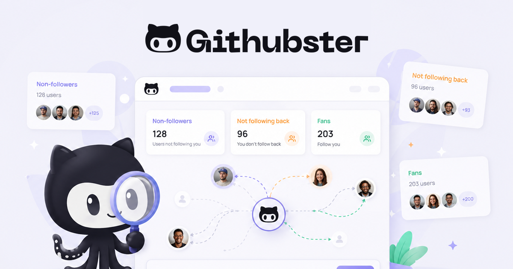

# Githubster



Track your GitHub followers, unfollowers and following relationships.

   

Githubster is a free, open-source tool that helps you understand your public GitHub social graph. It requests profile data directly from the GitHub API in your browser, without requiring a Githubster account.

## Features

- **Not Following Back** — people you follow who don't follow you back
- **You Don't Follow Back** — people who follow you but you don't follow back
- **Mutuals** — people you follow who also follow you
- **Following** — everyone you follow
- **Followers** — everyone who follows you
- **Profile Overview** — top languages, total stars, repositories
- Sort users by name (A→Z, Z→A)
- Search and filter within each tab
- Share profile link with one click
- Keyboard shortcut (`/`) to focus search
- Loading progress with skeleton animation
- Optional GitHub token for higher rate limits
- Dark/Light theme
- 20 languages supported (i18n with RTL)
- Web app manifest for standalone installation (GitHub data still requires a network connection)
- Browser-based profile analysis — usernames and optional tokens are sent directly to GitHub, not to a Githubster API
- SEO optimized with structured data (JSON-LD)

## Getting Started

```bash
# Install dependencies
npm install

# Run development server
npm run dev
```

Open [http://localhost:3000](http://localhost:3000) in your browser.

## Deployment

### Cloudflare Workers (production)

The production site runs on Cloudflare Workers using OpenNext. Prerendered pages
ship in Workers Static Assets, with no KV reads or writes during deployment or
page visits. GitHub profile requests still run directly in the visitor's browser.
No database, Workers KV, R2 subscription, or Hetzner connection is required.

`/api/stars` is a dynamic endpoint cached with Cloudflare's Cache API for one hour
per edge location. It does not use Next.js ISR or a revalidation queue. The build
fetches a public star-count snapshot and embeds it in the server bundle as a
fallback when GitHub throttles a shared egress IP. A successful runtime request
supersedes that snapshot while its edge cache entry exists. Cache eviction falls
back to the build snapshot; this optional count does not require persistent data.

Use Node.js 24 or newer and install the locked dependencies with `npm ci`.
Authenticate with `npx wrangler login` if needed. The Worker and its bindings are
configured in `wrangler.jsonc`.

Copy `.env.example` to `.env.production.local` for production builds and fill in
the public Umami settings. `NEXT_PUBLIC_*` values are embedded during the build,
so changing analytics settings requires rebuilding the app. Local Worker preview
also reads these environment files. Never commit production environment files.

Set the IndexNow runtime secrets separately:

```bash
npx wrangler secret put INDEXNOW_KEY
npx wrangler secret put INDEXNOW_SECRET
```

The verification key must stay the same as the existing public IndexNow key. Use
a separate random secret of at least 32 characters for authenticated submissions.

```bash
npm run lint
npm run typecheck
npm run cf:build
npm run cf:preview  # optional local workerd preview of the built app
npm run cf:deploy
npm run cf:smoke
```

`cf:deploy` deploys the existing `.open-next` build with its read-only cache in
Static Assets; it performs zero Workers KV puts. Run `cf:build` first after source
or build-time environment changes. Its `prebuild` step refreshes
`.generated/repository-stars.json` locally without any Cloudflare storage writes.
Deployment refuses a stale KV-based build, so a checkout update cannot silently
repopulate Workers KV before the new configuration has been built.
`public/_headers` gives hashed Next.js assets immutable browser caching.

The `githubster.com/*` and `www.githubster.com/*` Worker routes keep the existing
proxied DNS records. The apex redirects to `https://www.githubster.com` with the
path and query intact. Both domains are served by the Worker without calling an
origin server. The former Hetzner installation, PM2 entry, nginx site, and origin
certificate were removed on 2026-10-29. The existing proxied DNS records remain
only as route anchors; removing the Worker routes does not restore a working
Hetzner fallback. For Worker releases, `npx wrangler rollback` restores the previous
Worker version. The legacy KV namespace and Durable Object class from the initial
migration are retained for rollback but have no bindings in the current Worker.
Do not delete their historical data as part of an application rollback. Rolling
back to a version before the Static Assets fix reintroduces the KV quota issue.

After deployment, check the main and localized pages, `/sitemap.xml`,
`/robots.txt`, `/api/stars`, `/{INDEXNOW_KEY}.txt`, the `/jp` alias, and the CSS/JS
assets. `POST /api/indexnow` without valid authentication must return `401`.

### Node.js standalone (optional self-hosting)

`npm run build` creates a complete standalone deployment in `.next/standalone`. The post-build step copies both `.next/static` and `public` into that directory, so deploy the **entire** `.next/standalone` directory and start it with:

```bash
node server.js
```

Deploying only `server.js` or only the standalone JavaScript files will cause `/_next/static/*` assets to return `404`, leaving the site without styles and client-side behavior.

## GitHub Token (Optional)

Without a token, GitHub normally allows 60 REST API requests per hour per IP address. An authenticated personal account normally gets 5,000 requests per hour, but GitHub can apply different limits in some situations.

To create a token:

1. Open [GitHub Settings → Developer settings → Fine-grained tokens](https://github.com/settings/personal-access-tokens/new).
2. Create a fine-grained token with an expiration date and grant only the minimum access GitHub requires for the public endpoints you use.
3. Paste it into the optional token field. The value stays in the current page state, is used only for direct requests to `api.github.com`, and is cleared when the page is reloaded or closed.

GitHub recommends fine-grained tokens, limited permissions, and expiration dates. See [Keeping your API credentials secure](https://docs.github.com/en/rest/authentication/keeping-your-api-credentials-secure) and [permissions required for fine-grained tokens](https://docs.github.com/en/rest/authentication/permissions-required-for-fine-grained-personal-access-tokens).

## Tech Stack

- [Next.js 16](https://nextjs.org/) — React framework with Turbopack
- [React 19](https://react.dev/) — UI library
- [TypeScript 6](https://www.typescriptlang.org/) — type safety
- [Tailwind CSS 4](https://tailwindcss.com/) — utility-first styling
- [@tanstack/react-virtual](https://tanstack.com/virtual) — virtualized lists for large datasets
- [GitHub REST API](https://docs.github.com/en/rest) — data source

## Security

- Content Security Policy (CSP) headers
- Strict-Transport-Security (HSTS)
- X-Content-Type-Options, X-Frame-Options
- Permissions-Policy
- Profile analysis runs in the browser; Githubster does not persist usernames, GitHub responses, or optional tokens
- The optional token is a masked password field and can be revealed or cleared explicitly
- If Umami is configured, the site loads the configured analytics script; Githubster does not send GitHub tokens to it
- IndexNow submission requires a separate server-side bearer secret

## Environment variables

Copy `.env.example` to `.env.local` and set only the integrations you use.

| Variable | Purpose |
| --- | --- |
| `INDEXNOW_KEY` | Public IndexNow verification key, also served at `/{INDEXNOW_KEY}.txt` |
| `INDEXNOW_SECRET` | Private bearer secret required by `POST /api/indexnow`; use a random value of at least 32 characters, different from the public key |
| `NEXT_PUBLIC_UMAMI_WEBSITE_ID` | Optional Umami website identifier |
| `NEXT_PUBLIC_UMAMI_URL` | Optional analytics script URL |

Trigger IndexNow from a trusted deployment workflow or server environment:

```bash
curl --request POST https://www.githubster.com/api/indexnow \
  --header "Authorization: Bearer $INDEXNOW_SECRET"
```

`GET /api/indexnow` is intentionally unsupported, and the secret must never use a `NEXT_PUBLIC_` prefix.

## Supporting Githubster

The support section links to [Ko-fi](https://ko-fi.com/githubster), [PayPal](https://paypal.me/UmidM), and GitHub. The Ko-fi floating-chat widget is loaded after page hydration from `storage.ko-fi.com`.

## SEO release checklist

After deploying a release that changes public pages:

1. Verify `https://www.githubster.com/_next/static/` assets return `200` in browser DevTools.
2. Add and verify the `https://www.githubster.com/` property in Google Search Console and Bing Webmaster Tools.
3. Submit `https://www.githubster.com/sitemap.xml`, then request indexing for the homepage and the new `/tools/` and `/guides/` pages.
4. Trigger the protected IndexNow endpoint from a trusted deployment workflow after setting `INDEXNOW_KEY` and `INDEXNOW_SECRET`.
5. Review Search Console queries, pages, and CTR weekly; improve existing pages with impressions before adding new ones.

## Contributing

1. Fork the repository
2. Create a feature branch (`git checkout -b feature/my-feature`)
3. Commit your changes (`git commit -am 'Add my feature'`)
4. Push to the branch (`git push origin feature/my-feature`)
5. Open a Pull Request

## License

MIT
